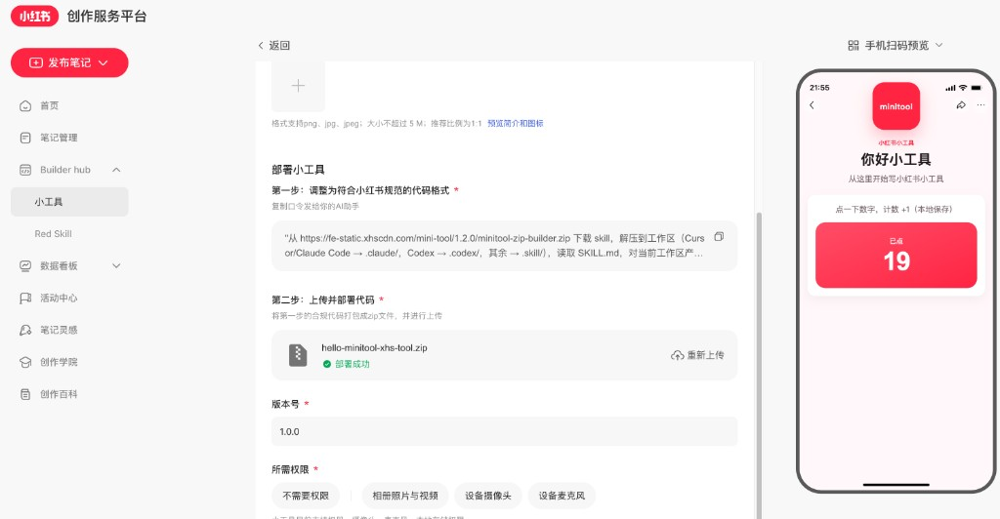

# XHS MiniTool

帮你从零开始做小红书小工具：一条命令创建项目，在电脑上写好页面，打包成 zip 上传到[创作服务平台](https://creator.xiaohongshu.com/new/red-app)即可。

小红书小工具是放在 App 里运行的**离线小网页**。页面、脚本、样式和图片都打进同一个 zip，用户打开时不依赖你自己的服务器。本仓库同时提供：

- 脚手架 `create-xhs-minitool`：独立项目的创建入口
- 打包与校验工具：把 Vite 产物整理成容器能加载的 zip
- `apps/` 里的示例小工具，以及文档站 [xhs-minitool.wenyuanw.me](https://xhs-minitool.wenyuanw.me)

- 官网（文档 + 示例）：https://xhs-minitool.wenyuanw.me
- 脚手架 npm：https://www.npmjs.com/package/create-xhs-minitool
- 源码：https://github.com/wenyuanw/xhs-minitool

## 三步上手

**1. 创建项目**（需要先安装 [Node.js](https://nodejs.org/) 18.17+）

```bash
npx create-xhs-minitool          # 按提示输入文件夹名
npx create-xhs-minitool my-tool  # 或直接指定名称
```

**2. 本地开发预览**

```bash
cd my-tool
pnpm install   # 也可用 npm / yarn
pnpm dev       # 在浏览器里预览，改代码会自动刷新
```

**3. 打包上传**

```bash
pnpm build     # 生成可上传的 zip
pnpm validate  # 上传前检查（推荐）
```

构建完成后，把 `<项目名>-xhs-tool.zip` 上传到创作服务平台。浏览器预览只用于开发；保存图片、发笔记和 Storage 需要在小红书容器里验证。



创建时只需输入文件夹名。标题、介绍默认跟名称走，主题色默认是小红书红 `#FF2442`，之后可以在项目里改。

## 用 AI 写第一个工具

新建项目里带了 `.agents/skills/`。把下面这段话交给 Cursor、Claude Code 等助手，把括号里的功能换成你的需求即可：

```text
我想做一个小红书小工具，功能是【在这里描述功能，例如：番茄钟计时器】。

请按以下步骤帮我完成：
1. 运行 npx create-xhs-minitool 创建项目（文件夹名用 kebab-case）
2. 阅读项目内 .agents/skills/ 中的小红书容器开发规范
3. 实现上述功能，确保纯离线、符合容器约束
4. 执行 pnpm build 打包，并执行 pnpm validate 检查
5. 告诉我 zip 文件路径和上传到创作服务平台的方法
```

## 创建后的项目

```text
my-tool/
  index.html          # 唯一页面入口
  src/main.js         # 页面逻辑，通常从这里改
  src/styles/         # 样式
  public/             # 图标、图片等静态资源
  vite.config.js      # 已接好共享构建配置
  .agents/skills/     # 容器规范，给人和 AI 助手读
```

`pnpm build` 会在项目目录生成：

| 产物 | 用途 |
|---|---|
| `xhs-tool/` | 整理好的提交目录，根上只有一个 `index.html` |
| `<项目名>-xhs-tool.zip` | 上传到创作服务平台的压缩包 |

## 脚手架里有什么

你不用自己配环境，项目里已经准备好了：

| 包 | npm 名 | 帮你做什么 |
|---|---|---|
| 创建项目 | [`create-xhs-minitool`](https://www.npmjs.com/package/create-xhs-minitool) | 生成 Vite + 原生 JS 项目 |
| 构建 | `xhs-minitool-vite-config` | 编译成相对路径、IIFE，目标为 ES2017 / Chrome 61 |
| 打包 | `xhs-minitool-pack` | 整理 `xhs-tool/` 并打成 zip |
| 校验 | `xhs-minitool-validate` | 上传前扫描常见兼容问题 |

四个包同版本发布，当前为 **0.1.2**。变更记录见 [CHANGELOG.md](CHANGELOG.md)。

## 仓库里的示例

不确定小工具长什么样，可以先看[在线 demo](https://xhs-minitool.wenyuanw.me/demos/)，或在本仓库克隆后单独启动：

| 目录 | 名称 | 做什么 | 本地预览 |
|---|---|---|---|
| `apps/hello-minitool` | 你好小工具 | 脚手架同款起步页 | `pnpm dev` |
| `apps/shu-emoji` | 薯 Emoji | 查表情含义、分类和收藏 | `pnpm dev:shu-emoji` |
| `apps/gegetu` | 格格图 | 最多 12 张图拼成一张，配文发笔记 | `pnpm dev:gegetu` |
| `apps/momo-avatar-maker` | 炫彩 momo | 模板或上传图片做头像 | `pnpm dev:momo-avatar-maker` |
| `apps/sony-shutter` | 快门查询 | 本地解析索尼、尼康照片的快门次数 | `pnpm dev:sony-shutter` |
| `apps/football-catch` | 绿茵门神 | 30 秒接球小游戏 | `pnpm dev:football-catch` |
| `apps/slow-paddle` | 慢桨 | 像素划水、收集与发明信片 | `pnpm dev:slow-paddle` |

各示例的玩法和打包说明写在对应目录的 `README.md`。

## 写代码前先知道的限制

容器是离线沙箱。核心流程必须在断网后仍然成立。

| 可以做 | 不要依赖 |
|---|---|
| 本地 HTML / CSS / JS、Canvas | 自己的后端、登录、远程素材、外链 |
| `window.xhs.miniTool` 保存图片、唤起笔记发布 | 网页下载、iframe、任意原生接口 |
| 客户端 9.46.0+ 的 Storage API | 把浏览器存储当成永久数据 |
| 包内图片、字体、JSON | WASM、Worker、动态执行代码 |

客户端 9.46.0 及以上优先用 Storage API 存业务数据；版本更低或读不到版本时，才按需降级到不保证持久性的浏览器存储。发笔记走 App 的发布流程，不能当成「断网也能发出去、一定审核通过」。

更完整的说明：

- [容器约束](https://xhs-minitool.wenyuanw.me/docs/container-limits/)
- [官方开发者文档与能力清单](https://miniapp-sandbox.xiaohongshu.com/minitool/doc)
- [官方打包 Skill 1.6.0](https://fe-static.xhscdn.com/mini-tool/20260831163932/minitool-zip-builder-1.6.0.skill)（已核验的下载版本；仓库维护版另按现行能力网页补充 API 差异）

## 文档

- [快速开始](https://xhs-minitool.wenyuanw.me/docs/getting-started/) — 从零创建第一个项目
- [项目结构](https://xhs-minitool.wenyuanw.me/docs/project-structure/) — 文件夹和命令说明
- [打包与校验](https://xhs-minitool.wenyuanw.me/docs/packaging/) — zip 怎么打、怎么检查
- [容器约束](https://xhs-minitool.wenyuanw.me/docs/container-limits/) — 哪些功能能做、不能做
- [官方资源](https://xhs-minitool.wenyuanw.me/docs/official-resources/) — 小红书平台官方说明

## 参与开发

克隆本仓库需要 Node `>= 18.17`、pnpm `>= 9`，以及系统里的 `zip` / `zipinfo`。校验脚本还需要 Python 3。

```bash
pnpm install
pnpm --filter shu-emoji dev       # 开发某一个示例
pnpm create-minitool              # 在 apps/<name> 新建工具
pnpm build                        # 构建全部小工具（不含官网）
pnpm validate
pnpm site:dev                     # 文档站，http://localhost:4321
```

```text
apps/          示例小工具与 Astro 官网
packages/      脚手架、Vite 配置、打包、校验
.agents/       布局约定与容器开发技能
docs/          贡献者说明与截图
```

发版、部署官网、技能同步见 [docs/DEVELOPMENT.md](docs/DEVELOPMENT.md)。

## License

[MIT](LICENSE)
